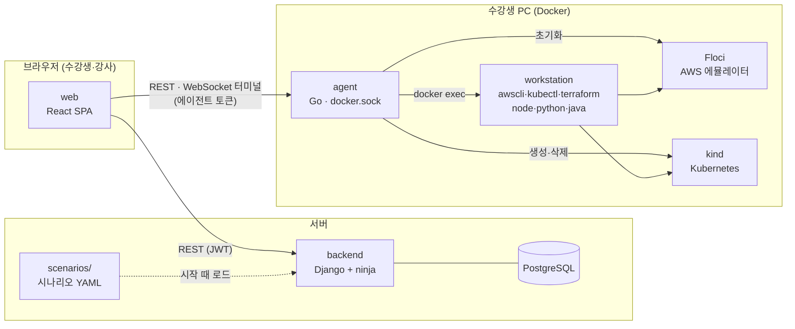

# infralab

**인프라 수업용 실습·채점 서비스.** 수강생은 브라우저에서 시나리오를 읽고, 자기 PC의 Docker 위에 올라온 실습 환경에서 고치고, 버튼 한 번으로 채점받습니다. 강사는 기수별 진행 현황을 한눈에 봅니다.


## 🧭 무엇을 하는 서비스인가

- **수강생**: 소셜 로그인(카카오) 후 강사가 준 가입 링크로 기수에 들어갑니다. 안내에 따라 받은 `compose.yml` 을 자기 PC에서 `docker compose up` 하면 실습 환경(workstation·Floci·에이전트)이 뜹니다. 시나리오 화면에서 문제를 읽고, 화면 안 브라우저 터미널로 직접 고친 뒤 채점합니다. 통과 여부와 힌트가 바로 나옵니다.
- **강사**: 기수를 만들고 가입 링크를 관리하며, 수강생 × 시나리오 격자로 진행 상황을 봅니다. 칸을 누르면 제출 이력, 검사별 통과·실패와 원시 출력, 제출에 붙은 AI 대화 기록(Claude Code·Codex)을 볼 수 있습니다.
- **서버는 학생 PC에 접근하지 않습니다.** 서버 주소도 서버 자격증명도 학생 PC의 에이전트는 모릅니다. 브라우저가 서버와 에이전트 사이에서 요청과 결과를 옮깁니다.

### 주요 기능

- 기수 만들기·가입 링크 재발급·가입 닫기·학생 내보내기·보관
- 학생마다 만들어 주는 `compose.yml` 과 에이전트 토큰 재발급
- 시나리오 화면: 환경 준비 → 실습 → 채점. 환경 준비 전에는 채점이 잠깁니다
- 브라우저 터미널(xterm.js): 탭 최대 4개, 폭 조절·접기·전체화면, 글자 크기, 복사·붙이기
- 검사 두 묶음: 목표 검사와 **제약 검사**(예: 「Deployment 를 지우고 다시 만들지 않았다」)
- 제출에 AI 대화 기록 첨부(환경 준비 이후 Claude Code·Codex 발화만)
- 강사 격자(고정 헤더)·제출 Drawer, 라이트·다크 테마

### 시나리오

| id | 제목 |
| --- | --- |
| `s3-static-site` | S3 정적 사이트 |
| `terraform-s3` | Terraform 으로 S3 |
| `ec2-web-server` | EC2 웹 서버 |
| `ec2-unreachable` | 닿지 않는 EC2 |
| `k8s-basics` | Kubernetes 기초 |
| `k8s-web-down` | 응답하지 않는 web |
| `node-api-repair` | 고장 난 Node API |
| `python-api-feature` | Python API 에 기능 추가 |
| `java-api-repair` | 고장 난 Java API |

## 🏗️ 구조



채점 흐름: 브라우저가 서버에서 시나리오의 검사 정의를 받아 → 에이전트 `/api/check` 로 보내 workstation 안에서 돌리고 → 결과를 서버에 제출로 저장합니다.

## 📁 폴더 구조

| 폴더 | 내용 |
| --- | --- |
| `agent/` | 학생 PC 에서 도는 Go 단일 바이너리(`infra-agent`). 검사 실행, 환경 준비, Floci·kind 제어, 브라우저 터미널 중계. 자세한 API 는 [`agent/README.md`](agent/README.md) |
| `backend/` | Django 5.2 + django-ninja API. 앱: `accounts`(소셜 로그인·JWT), `cohorts`, `scenarios`, `submissions` |
| `web/` | React 18 + Vite + TypeScript, Mantine 8, xterm.js. [`web/README.md`](web/README.md) |
| `docker/` | 개발용 compose(`compose.dev.yaml`), backend 이미지, 학생용 `workstation` 이미지 |
| `scenarios/` | 시나리오 YAML 과 setup·검사 스크립트. `_shared/` 는 시나리오 공용 스크립트 |
| `docs/` | 실측·조사 기록 |

## 🚀 로컬에서 실행

개발용 스택(Postgres + backend + web)은 compose 하나로 뜹니다.

```bash
docker compose -f docker/compose.dev.yaml up
```

| 서비스 | 기본 포트 | 바꾸는 환경변수 |
| --- | --- | --- |
| web (Vite) | 53040 | `INFRALAB_WEB_PORT` |
| backend | 58040 | `INFRALAB_API_PORT` |
| Postgres | 55440 | `INFRALAB_DB_PORT` |

- `VITE_KAKAO_REST_KEY` 를 주면 카카오 로그인, 비우면 Fake 로그인만 보입니다(backend 도 같은 값을 보고 어댑터를 고릅니다).
- 시나리오 YAML 은 서버가 시작할 때 읽으니, 고치면 backend 를 재기동하세요.
- 학생 PC 쪽 compose(에이전트·workstation·Floci)는 서버가 학생마다 만들어 주는 별개 파일입니다. 에이전트·workstation 이미지는 로컬에서 빌드해 씁니다.

```bash
docker build --build-arg VERSION=0.1.0-dev -t infralab/agent:dev agent/
docker build -t infralab/workstation:dev docker/workstation/
```

에이전트 환경변수(`AGENT_TOKEN`, `AGENT_ALLOWED_ORIGINS`, `AGENT_ADDR`, `WORKSTATION_CONTAINER`, `FLOCI_CONTAINER`, `KIND_CLUSTER`)의 뜻은 [`agent/README.md`](agent/README.md) 에 있습니다.

## 📝 시나리오 작성 요약

시나리오는 `scenarios/<id>/scenario.yaml` 한 파일과 필요한 스크립트로 이루어집니다.

```yaml
id: k8s-web-down
title: 응답하지 않는 web
description: |          # 학생에게 보이는 Markdown 본문
  ...
requires:               # 환경 준비 때 되돌릴 것
  floci: false
  kind: { control_planes: 1, workers: 2 }
setup: setup.sh         # 고장을 심는 스크립트 (setup_timeout_seconds 로 시간 한도)
ai_rules: |             # workstation 의 CLAUDE.md·AGENTS.md 에 들어갈 AI 사용 규칙
  ...
checks:
  - id: deployment-ready
    name: Deployment web 의 ready 레플리카 2개 이상
    hint: kubectl scale deployment web --replicas=2
    command: ...        # workstation 에서 bash -lc 로 실행
    expect: { regex: "^\\s*([2-9]|[1-9][0-9]+)\\s*$" }
    timeout_seconds: 90
  - id: image-kept
    command: ...
    expect: { regex: "^nginx(:|$)" }
    constraint: true    # 제약 검사
```

- `expect` 종류: `exit_zero`, `equals`, `contains`, `regex`, `jsonpath`
- `constraint: true` 는 「이렇게 고치면 안 된다」를 확인하는 제약 검사입니다.
- 스크립트는 시나리오 폴더 또는 `scenarios/_shared/` 에 두고 명령에서 이름으로 부릅니다.
- 스키마 정의·검증은 `backend/scenarios/` 의 `schemas.py`·`loader.py`, 깨진 파일은 시험과 부팅에서 걸립니다.

실습 코드는 별도 공개 저장소 [`infralab-labs`](https://github.com/sandcorporation/infralab-labs) 에 있습니다(규칙은 [`docs/labs-repo.md`](docs/labs-repo.md)).

## 🧪 시험

PR 검사(GitHub Actions `ci`)와 같은 검사: `scripts/ci.sh <backend|web|agent|all>` (uv·node·go 필요, backend 는 Postgres 도).

| 대상 | 명령 |
| --- | --- |
| backend | `docker compose -f docker/compose.dev.yaml run --rm backend pytest` |
| web | `npm test`(vitest), `npm run typecheck` — `web/` 에서 |
| agent | Docker 의 Go 툴체인으로 `gofmt -l . ; go vet ./... && go test ./...` (전체 명령은 [`agent/README.md`](agent/README.md)) |
| agent 통합 | `integration` 빌드 태그, 실제 Docker·학생 compose 스택 필요. 손으로만 실행 — Floci 상태와 kind 클러스터가 지워지니 주의 |

## 📚 더 읽을 문서

- [`agent/README.md`](agent/README.md) — 에이전트 API·구조·시험
- [`web/README.md`](web/README.md) — 화면 구조·터미널 키
- [`docs/floci-findings-2026-10-22.md`](docs/floci-findings-2026-10-22.md) — Floci 실측
- [`docs/scenario-notes-2026-10-23.md`](docs/scenario-notes-2026-10-23.md) — 고장·제약 시나리오 메모
- [`docs/ai-session-formats-2026-10-23.md`](docs/ai-session-formats-2026-10-23.md) — Claude·Codex 세션 파일 형식
- [`docs/browser-to-agent-2026-10-22.md`](docs/browser-to-agent-2026-10-22.md) — 브라우저에서 에이전트 접근 확인
- [`docs/poc-findings-2026-10-22.md`](docs/poc-findings-2026-10-22.md) — 에이전트 PoC 기록
- [`docs/labs-repo.md`](docs/labs-repo.md) — 실습 코드 저장소 규칙
